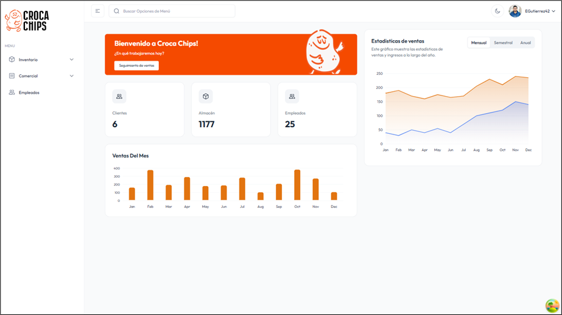

# 🚀 Sistema de Gestión de Inventarios para Croca Chips

     



## 📝 Descripción del Proyecto

Este proyecto es el frontend de un sistema integral de gestión de inventarios diseñado específicamente para la empresa "Croca Chips". 🥔 Desarrollado con **React** y **TypeScript**, sigue una arquitectura modular y escalable basada en **Feature-Sliced Design (FSD)**. El sistema permite a Croca Chips administrar eficientemente sus productos, inventario, clientes, empleados y ventas, optimizando los flujos de trabajo internos y proporcionando una visión clara de las operaciones. Su objetivo es mejorar la eficiencia y la toma de decisiones en la gestión de stock y recursos.

## ✨ Características Principales

Este sistema ofrece un conjunto robusto de funcionalidades para una gestión completa:

*   **📦 Gestión de Productos:** Agrega, edita, elimina y gestiona el stock de todos los productos de Croca Chips.
*   **👥 Gestión de Clientes:** Mantén una base de datos completa de clientes con opciones CRUD (Crear, Leer, Actualizar, Eliminar).
*   **👨‍💼 Gestión de Empleados:** Administra la información detallada del personal de la empresa.
*   **📊 Gestión de Inventario:**
    *   **📤 Despachos:** Registra y sigue las salidas de productos del almacén.
    *   **📥 Recepciones:** Registra y gestiona las entradas de nuevos productos o devoluciones.
    *   **🏷️ Control de Lotes:** Gestión detallada del inventario por lotes de productos.
*   **💰 Gestión de Ventas:** Registra y haz seguimiento de todas las transacciones de venta.
*   **🔒 Autenticación Segura:** Acceso protegido mediante inicio de sesión con JSON Web Tokens (JWT).
*   **🎨 Interfaz de Usuario Intuitiva:** Diseño moderno y fácil de usar, con componentes reutilizables y una experiencia de usuario fluida.
*   **📈 Dashboards y Reportes:** Visualiza datos clave a través de gráficos interactivos (barras, líneas) para una toma de decisiones informada sobre inventario y ventas.
*   **🌙 Temas Personalizables:** Soporte para cambiar entre diferentes temas de interfaz, mejorando la experiencia visual del usuario.

## ⚙️ Requisitos Previos

Antes de ejecutar este proyecto, asegúrate de tener instalado lo siguiente en tu entorno de desarrollo:

*   **Node.js:** Versión 18 o superior. Puedes descargarlo desde [nodejs.org](https://nodejs.org/).
*   **npm** o **Yarn:** Un gestor de paquetes de JavaScript. `npm` viene incluido con Node.js; `Yarn` se puede instalar globalmente.
*   **Git:** Para clonar el repositorio. Descárgalo desde [git-scm.com](https://git-scm.com/).

## 🚀 Instrucciones de Instalación

Sigue estos pasos para configurar y ejecutar el proyecto localmente:

1.  **Clonar el repositorio:**
    ```bash
    git clone https://github.com/Mah0j0/CrocaChips-Frontend.git
    cd CrocaChips-Frontend
    ```

2.  **Instalar dependencias:**
    ```bash
    npm install
    # o si usas Yarn
    # yarn install
    ```

3.  **Configuración de Variables de Entorno:**
    Crea un archivo `.env` en la raíz del proyecto (si no existe) y configura las variables de entorno necesarias, como la URL de la API backend.
    ```
    VITE_API_URL=http://localhost:3000/api
    ```
    *(Ajusta `VITE_API_URL` según la configuración de tu backend. Asegúrate de que el backend esté en funcionamiento.)*

4.  **Iniciar el servidor de desarrollo:**
    ```bash
    npm run dev
    # o si usas Yarn
    # yarn dev
    ```
    Esto iniciará la aplicación en modo de desarrollo, generalmente accesible en `http://localhost:5173`. Abre esta URL en tu navegador.

5.  **Construir para producción (opcional):**
    ```bash
    npm run build
    # o si usas Yarn
    # yarn build
    ```
    Esto generará los archivos optimizados y estáticos para producción en la carpeta `dist/`.

## 🧑‍💻 Guía de Uso

Una vez que la aplicación esté en funcionamiento, sigue estos pasos básicos:

1.  **Inicio de Sesión:** Accede a la aplicación utilizando tus credenciales de usuario. Si es la primera vez, asegúrate de que el backend tenga usuarios preconfigurados o un mecanismo de registro.
2.  **Navegación:** Utiliza la barra lateral intuitiva para navegar entre las diferentes secciones: `Dashboard`, `Clientes`, `Empleados`, `Productos`, `Despachos`, `Recepciones`, `Ventas`, y `Lotes`.
3.  **Gestión de Datos:** En cada sección, podrás realizar operaciones de crear, leer, actualizar y eliminar (CRUD) según tus permisos. Por ejemplo, en "Productos" podrás añadir un nuevo producto, editar su información o actualizar su stock.
4.  **Filtros y Búsquedas:** Utiliza las opciones de filtrado y búsqueda disponibles en las tablas para encontrar información específica rápidamente.
5.  **Reportes:** Consulta los dashboards para obtener una visión gráfica y en tiempo real del rendimiento del negocio y el estado del inventario.

## 🌳 Estructura del Proyecto

El proyecto sigue la arquitectura **Feature-Sliced Design (FSD)**, lo que garantiza una organización clara, modular y escalable. A continuación, se detalla la estructura principal:
```
CrocaChips-Frontend/
├── public/                 # 🌐 Archivos estáticos (imágenes, favicon, etc.)
├── src/                    # 🚀 Código fuente de la aplicación
│   ├── app/                # ⚙️ Lógica global de la aplicación, proveedores (contextos)
│   │   ├── providers/      # Contextos globales (Modal, Sidebar, Theme, etc.)
│   │   ├── App.tsx         # Componente principal de la aplicación
│   │   └── main.tsx        # Punto de entrada de la aplicación
│   ├── entities/           # 🧩 Definiciones de entidades de negocio y su lógica básica
│   │   ├── clientes/
│   │   ├── dashboard/
│   │   ├── empleados/
│   │   ├── movimientos/
│   │   ├── productos/
│   │   └── ventas/
│   ├── features/           # ✨ Funcionalidades de negocio específicas (interacciones con entidades)
│   │   ├── auth/           # Módulo de autenticación (login, registro)
│   │   ├── clientes/       # Funcionalidades de clientes (crear, editar, eliminar, tablas)
│   │   ├── despachos/
│   │   ├── empleados/
│   │   ├── productos/
│   │   ├── recepciones/
│   │   └── ventas/
│   ├── pages/              # 📄 Páginas de la aplicación (composición de features y entities)
│   │   ├── Almacen/        # Páginas relacionadas con el almacén (Despachos, Lotes, Productos, Recepciones)
│   │   ├── AuthPages/      # Páginas de autenticación (SignIn, SignUp)
│   │   ├── Clientes/
│   │   ├── Dashboard/
│   │   ├── Empleados/
│   │   ├── Plantilla/      # Páginas de ejemplo o utilidades de plantilla
│   │   └── Ventas/
│   └── shared/             # 🤝 Código reutilizable y transversal a toda la aplicación
│       ├── Charts/         # Componentes de gráficos (Barras, Líneas, etc.)
│       ├── data/           # Datos estáticos o de configuración
│       ├── hooks/          # Hooks personalizados de React
│       ├── icons/          # Iconos SVG y componentes de iconos
│       ├── layout/         # Componentes de layout (Header, Sidebar, Layout principal)
│       ├── lib/            # Librerías y utilidades (e.g., axios.ts, jwt.ts)
│       ├── ui/             # Componentes UI básicos y reutilizables (Botones, Inputs, Modales)
│       └── utils/          # Funciones de utilidad (e.g., ProtectedRoute, formatters)
├── .eslintrc.js            # 🧹 Configuración de ESLint para linting de código
├── index.html              # 🌐 Archivo HTML principal de la aplicación
├── package.json            # 📦 Metadatos del proyecto y dependencias
├── tsconfig.json           # 📝 Configuración de TypeScript
├── vite.config.ts          # ⚡ Configuración de Vite
└── ... otros archivos de configuración y assets
```

## 🛠️ Tecnologías Utilizadas

Las principales tecnologías y librerías empleadas en el desarrollo de este proyecto son:

*   **Frontend Framework:** [React](https://react.dev/) (con Hooks y Context API)
*   **Lenguaje de Programación:** [TypeScript](https://www.typescriptlang.org/)
*   **Arquitectura:** [Feature-Sliced Design (FSD)](https://feature-sliced.design/)
*   **Build Tool:** [Vite](https://vitejs.dev/)
*   **Gestión de Estado/Datos Asíncronos:** [React Query](https://tanstack.com/query/latest)
*   **Validación de Esquemas:** [Zod](https://zod.dev/)
*   **Animaciones:** [Framer Motion](https://www.framer.com/motion/)
*   **Autenticación:** [JSON Web Tokens (JWT)](https://jwt.io/)
*   **Peticiones HTTP:** [Axios](https://axios-http.com/)
*   **Estilización:** (Se recomienda especificar si se usa Tailwind CSS, Styled Components, etc., si aplica)
*   **Enrutamiento:** [React Router DOM](https://reactrouter.com/en/main)